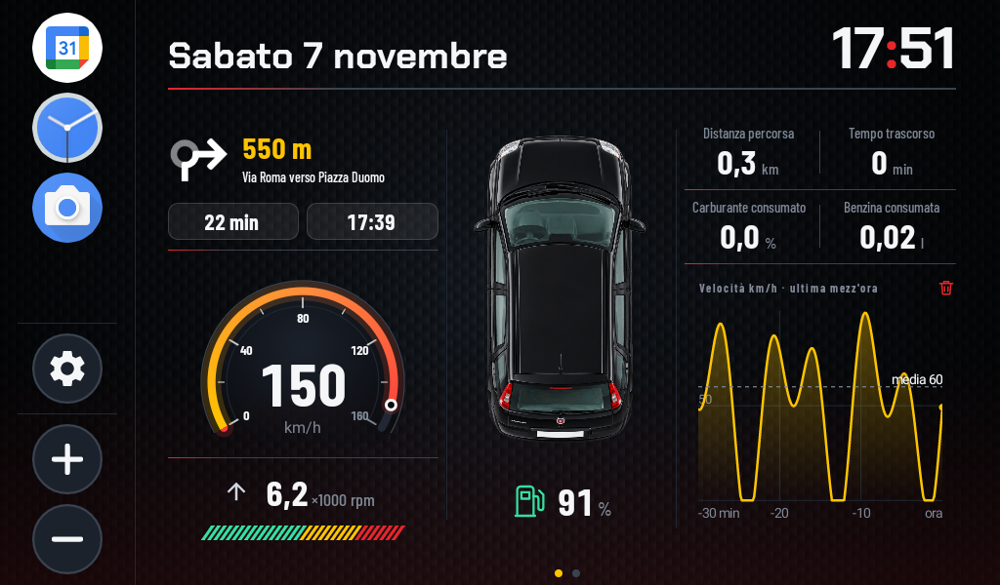

# Panda Launcher

**Un cruscotto digitale su misura per una Fiat Panda 169, costruito da zero come launcher Android per un'autoradio cinese.**

La radio di serie mostra icone e un'app per la musica. Questo progetto la trasforma in un cruscotto: tachimetro e contagiri
disegnati a mano, dati veri letti dalla centralina, indicazioni di Google Maps direttamente nella Home, la frequenza
della radio, la diagnosi degli errori motore. Tutto in Java, senza librerie di terzi per l'interfaccia, pensato per leggersi
con un'occhiata mentre si guida.



## Cosa fa

### Home: velocità, giri e viaggio in tre colonne

- **Tachimetro** disegnato in codice (`GaugeView`): quadrante scuro con sfumatura, arco di 240°, tacche e numeri, fondo scala configurabile.
- **Giri motore** in migliaia, con una barra a segmenti che si riempie fino ai giri di cambio marcia (da impostare).
  Una freccia grigia lampeggia verso l'alto quando conviene salire di marcia e verso il basso quando si sta in marcia sotto i giri minimi.
- **Auto vista dall'alto** al centro, con il livello del serbatoio.
- **Computer di bordo**: distanza, tempo, percentuale e litri di carburante consumati, e (opzionale) velocità media e costo in euro.
  Sotto, un grafico della velocità nell'ultima mezz'ora, con la media.
- **Sezione "Dati aggiuntivi" sopra il tachimetro**, a scelta tra *Disattivato*, *Navigatore* e *Radio*:

| Navigatore (goESP) | Radio |
|---|---|
|  |  |

  - **Navigatore**: freccia della manovra, distanza, via, tempo e orario di arrivo. I dati arrivano dall'app **goESP** sul telefono,
    che il launcher imita come se fosse il suo display.
  - **Radio**: la frequenza (titolo e descrizione) letta dalla notifica dell'app radio dell'autoradio.

### Seconda pagina: l'auto e i suoi dati

L'auto è al centro, con i dati sopra e sotto collegati da linee ai punti della carrozzeria. A destra, in una colonna stretta
perché spesso è vuota, gli errori letti dalla centralina.


- **Misurati**: temperatura acqua, tensione batteria (con l'icona della carica dell'alternatore), livello serbatoio,
  temperatura dell'aria aspirata, carico motore, posizione dell'acceleratore.
- **Stimati**: carburante residuo in litri e autonomia, calcolata dal consumo medio del viaggio.
- **Errori**: pulsante *Leggi allarmi* e lista con spia motore, codici di errore memorizzati e in attesa, e avvisi ricavati dai valori
  (acqua troppo calda, batteria che non carica). I codici sono tradotti in italiano.

### Il resto

- Colonna delle app scelte, con impostazioni e tasti del volume.
- Icone, scritte e riquadri semitrasparenti pensati per essere leggibili da un posto di guida, su uno schermo scuro.
- Modalità dimostrativa con dati finti per provare tutta la grafica senza auto né adattatore.

## Sotto il cofano

**OBD senza strumenti da officina.** Un adattatore ELM327 economico parla con la centralina via Bluetooth (RFCOMM).
Il launcher chiede i PID standard uno alla volta (la centralina del Fire risponde in circa 280 ms a richiesta),
li interpreta e ne ricava un'istantanea dei dati. La lettura continua anche quando si usa un'altra app.

**Un consumo che nessuno ti dà, stimato bene.** Il motore Fire non comunica il consumo e di solito nemmeno il flusso d'aria.
`FuelEstimator` lo ricostruisce con il metodo *speed-density*: dalla pressione nel collettore, dai giri, dalla temperatura dell'aria
e dalla cilindrata ricava l'aria aspirata, e da quella la benzina (rapporto stechiometrico 14,7).
`FuelCalibrator` poi **si tara da solo**: confronta i litri stimati con il calo reale del livello del serbatoio
e corregge il modello con un fattore che si aggiorna piano, ignorando rumore e rifornimenti.
Da qui escono anche costo del viaggio e autonomia.

**Un display che il telefono crede vero.** Per la navigazione il launcher si comporta come un display goESP (basato su ESP32):
pubblica via Bluetooth Low Energy lo stesso servizio GATT e il telefono vi scrive i pacchetti di manovra.
Nessun server, nessun cloud, nessuna app da modificare.

**La radio, senza toccare la radio.** Un `NotificationListenerService` legge la notifica di riproduzione dell'app radio
(categoria *transport* o stile multimediale) e ne mostra titolo e descrizione.

**Grafica disegnata a mano.** Tachimetro, barra dei giri, grafico della velocità e linee dall'auto sono `View` personalizzate
disegnate su `Canvas`: le linee seguono i punti della foto qualunque sia la dimensione dello schermo.

**Diagnosi.** Decodifica dei codici di errore OBD-II (modi 03 e 07) con un catalogo in italiano, e regole che trasformano
i valori letti in avvisi.

**Testato.** Le parti senza dipendenze Android (parser OBD, stime di consumo, taratura, trip, diagnosi, storico velocità)
sono classi pure con test JUnit.

## Struttura

```
FPLauncher/
  app/src/main/
    java/it/panda/launcher/
      LauncherActivity.java      Home e seconda pagina, tutta la logica dello schermo
      SettingsActivity.java      app, OBD, dati aggiuntivi, modello, tachimetro, consumi
      AppPickerActivity.java     scelta e ordine delle app della colonna
      Prefs.java                 impostazioni salvate
      obd/                       ELM327, PID, parser, stime di consumo, taratura, trip, diagnosi
      nav/                       ricevitore goESP via Bluetooth LE e dati di navigazione
      radio/                     lettura della notifica dell'app radio
      apps/                      elenco delle app installate
      ui/                        GaugeView, ShiftLightsView, CarLinesView, MetricCellView, grafico
    assets/directions/           frecce delle manovre
  app/src/test/                  test JUnit
Extra/
  APK/                           APK compilata
  Immagini/                      foto dell'auto e screenshot
```

## Compilare e installare

Servono JDK 17 o superiore e Android SDK (minSdk 24, targetSdk 34).

1. Apri la cartella `FPLauncher` in Android Studio, oppure da riga di comando:
   `gradle :app:assembleDebug :app:testDebugUnitTest`
2. L'APK è in `FPLauncher/app/build/outputs/apk/debug/app-debug.apk`; una copia pronta è in `Extra/APK/PandaLauncher.apk`.
3. Installala sull'autoradio (USB con debug attivo, oppure da chiavetta).
4. Premi Home e scegli **Panda Launcher** → "Sempre". Il launcher originale resta installato e si può riattivare.

## Impostazioni

Dalla Home, ingranaggio in basso a sinistra:


- **OBD**: attivazione e scelta dell'adattatore ELM327 già associato dalle impostazioni Bluetooth di Android (PIN di solito `1234` o `0000`).
- **Dati aggiuntivi**: Disattivato, Navigatore (goESP) o Radio. Per la radio serve l'accesso alle notifiche, che si concede dalle impostazioni di sistema.
- **Modello**: Fiat Panda 169 AXF1A 08B, 1242 cm³ (altri modelli si aggiungono in `Prefs`).
- **Tachimetro e giri**: fondo scala (160 km/h di default), giri per cambiare marcia (6000), giri minimi (1500), giri massimi (6500).
- **Consumi**: taratura automatica, capacità del serbatoio (38 l), consumo dettagliato con velocità media e costo, prezzo del carburante (1,90 €/l).

## Stato

Progetto personale in uso e in sviluppo. L'interfaccia, la lettura OBD e le stime sono provate; la navigazione via goESP e la lettura
della radio dipendono dall'hardware dell'autoradio (Bluetooth LE in modalità periferica, app radio che pubblica una notifica di riproduzione).
Porte, finestrini e climatizzatore non fanno parte dell'OBD standard e richiederebbero i comandi Fiat del Body Computer.
