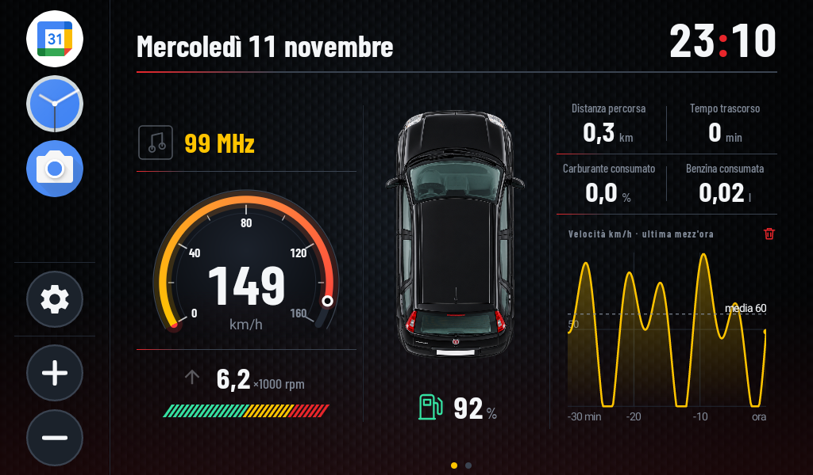
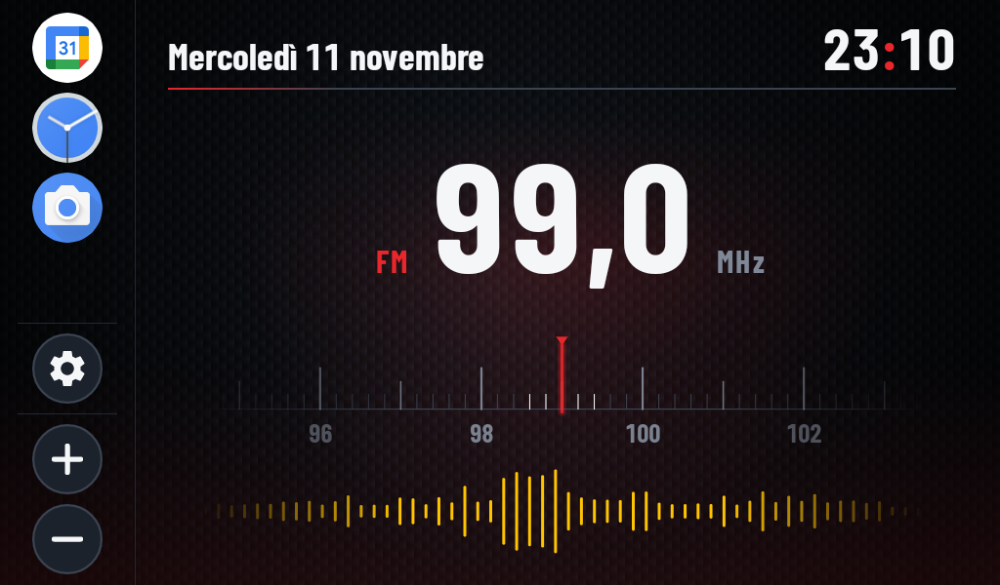
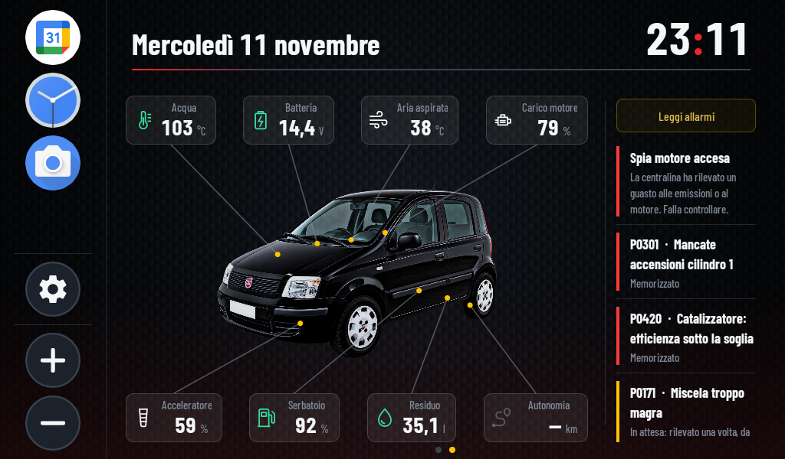
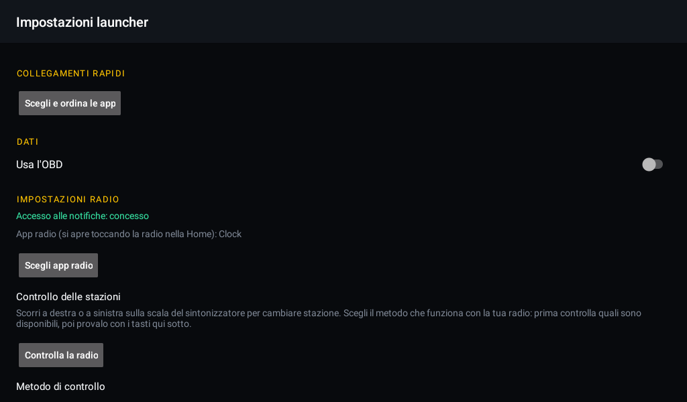
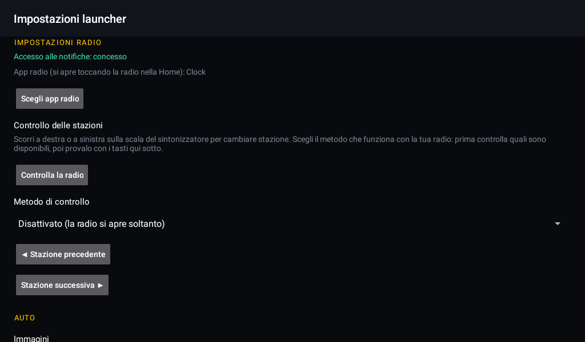

# FIAT Panda Launcher

🇮🇹 Italiano · [🇬🇧 English](README.md)

**Un cruscotto digitale su misura per una Fiat Panda 169, costruito da zero come launcher Android per un'autoradio cinese.**

La radio di serie mostra icone e un'app per la musica. Questo progetto la trasforma in un cruscotto: tachimetro e contagiri
disegnati a mano, dati veri letti dalla centralina, la frequenza della radio, la diagnosi degli errori motore e un sintonizzatore
a schermo intero per quando i dati dell'auto non servono. Tutto in Java, senza librerie di terzi per l'interfaccia, pensato per leggersi
con un'occhiata mentre si guida.



## Due modalità

Il launcher ha due modalità, che si scelgono nelle impostazioni (**Usa l'OBD**):

| OBD attivo: due pagine | OBD spento: la radio |
|---|---|
| Home (velocità, giri, viaggio) e pagina dei dati dell'auto | Una sola pagina con il sintonizzatore |
|  |  |

Un adattatore OBD Bluetooth lasciato inserito può scaricare la batteria di un'auto ferma, quindi l'OBD si può spegnere del tutto.
In quel caso le pagine dell'auto spariscono: resta solo la radio, con la barra di data e ora in alto come sempre.

### OBD attivo, prima pagina: velocità, giri e viaggio in tre colonne

- **Tachimetro** disegnato in codice (`GaugeView`): quadrante scuro con sfumatura, arco di 240°, tacche e numeri, fondo scala configurabile.
- **Giri motore** in migliaia, con una barra a segmenti che si riempie fino ai giri di cambio marcia (da impostare).
  Una freccia grigia lampeggia verso l'alto quando conviene salire di marcia e verso il basso quando si sta in marcia sotto i giri minimi.
- **Frequenza della radio** sopra il tachimetro, letta dalla notifica dell'app radio. Toccandola si apre l'app radio.
- **Auto vista dall'alto** al centro, con il livello del serbatoio.
- **Computer di bordo**: distanza, tempo, percentuale e litri di carburante consumati, e (opzionale) velocità media e costo in euro.
  Sotto, un grafico della velocità nell'ultima mezz'ora, con la media.

### OBD attivo, seconda pagina: l'auto e i suoi dati

L'auto è al centro, con i dati sopra e sotto collegati da linee ai punti della carrozzeria. A destra, in una colonna stretta
perché spesso è vuota, gli errori letti dalla centralina.



- **Misurati**: temperatura acqua, tensione batteria (con l'icona della carica dell'alternatore), livello serbatoio,
  temperatura dell'aria aspirata, carico motore, posizione dell'acceleratore.
- **Stimati**: carburante residuo in litri e autonomia, calcolata dal consumo medio del viaggio.
- **Errori**: pulsante *Leggi allarmi* e lista con spia motore, codici di errore memorizzati e in attesa, e avvisi ricavati dai valori
  (acqua troppo calda, batteria che non carica). I codici sono tradotti in italiano.

### OBD spento: il sintonizzatore della radio

Una sola pagina a schermo intero, disegnata come uno strumento del cruscotto (`RadioTunerView`):

- la **frequenza** in grande, con la banda (FM o AM) e l'unità, sullo stesso alone rosso che sta dietro al tachimetro;
- una **scala a nastro** da 87,5 a 108 MHz che scorre sotto una lancetta rossa fissa quando cambia la stazione;
- una sottile **forma d'onda** speculare che si muove mentre una stazione è in riproduzione (è simulata, non ascolta l'audio).

Senza stazione compare *Radio FM*, con la scala attenuata. Toccando il sintonizzatore si apre l'app radio scelta nelle impostazioni.

**Cambiare stazione.** Scorri la scala da destra a sinistra per la stazione successiva, da sinistra a destra per la precedente: la scala
segue il dito e torna al centro. Ogni autoradio cinese si comporta a modo suo, quindi il metodo di controllo si sceglie nelle
impostazioni (vedi sotto). Con *Disattivato* lo scorrimento è spento e resta solo il tocco che apre l'app radio.

### Il resto

- Colonna delle app scelte, con impostazioni e tasti del volume.
- Icone, scritte e riquadri semitrasparenti pensati per essere leggibili da un posto di guida, su uno schermo scuro.
- Modalità dimostrativa con dati finti per provare tutta la grafica senza auto né adattatore: con l'OBD attivo simula i dati dell'auto,
  con l'OBD spento simula una stazione radio (99 MHz).

## Sotto il cofano

**OBD senza strumenti da officina.** Un adattatore ELM327 economico parla con la centralina via Bluetooth (RFCOMM).
Il launcher chiede i PID standard uno alla volta (la centralina del Fire risponde in circa 280 ms a richiesta),
li interpreta e ne ricava un'istantanea dei dati. La lettura continua anche quando si usa un'altra app.

**Un consumo che nessuno ti dà, stimato bene.** Il motore Fire non comunica il consumo e di solito nemmeno il flusso d'aria.
`FuelEstimator` lo ricostruisce con il metodo *speed-density*: dalla pressione nel collettore, dai giri, dalla temperatura dell'aria
e dalla cilindrata ricava l'aria aspirata, e da quella la benzina (rapporto stechiometrico 14,7).
`FuelCalibrator` poi **si tara da solo**: confronta i litri stimati con il calo reale del livello del serbatoio
e corregge il modello con un fattore che si aggiorna piano, ignorando rumore e rifornimenti.
Da qui escono anche costo del viaggio e autonomia.

**La radio, senza toccare la radio.** Un `NotificationListenerService` legge la notifica di riproduzione dell'app radio
(categoria *transport* o stile multimediale) e ne ricava la frequenza. Per cambiare stazione `RadioControl` prova i metodi che
l'autoradio può accettare: la sessione multimediale pubblicata dall'app radio, un tasto multimediale inviato al suo pacchetto,
o il tasto multimediale di sistema. Le impostazioni controllano quali sembrano disponibili e permettono di provarli.

**Grafica disegnata a mano.** Tachimetro, barra dei giri, grafico della velocità, sintonizzatore e linee dall'auto sono `View` personalizzate
disegnate su `Canvas`: le linee seguono i punti della foto qualunque sia la dimensione dello schermo.

**Diagnosi.** Decodifica dei codici di errore OBD-II (modi 03 e 07) con un catalogo in italiano, e regole che trasformano
i valori letti in avvisi.

**Testato.** Le parti senza dipendenze Android (parser OBD, stime di consumo, taratura, trip, diagnosi, storico velocità)
sono classi pure con test JUnit.

## Struttura

```
FPLauncher/
  app/src/main/
    java/it/panda/launcher/
      LauncherActivity.java      Home, pagina dei dati e pagina radio, tutta la logica dello schermo
      SettingsActivity.java      app, OBD, radio, immagini dell'auto, motore, tachimetro, consumi
      AppPickerActivity.java     scelta e ordine delle app della colonna
      Prefs.java                 impostazioni salvate
      obd/                       ELM327, PID, parser, stime di consumo, taratura, trip, diagnosi
      radio/                     notifica dell'app radio, controllo delle stazioni (RadioControl)
      apps/                      elenco delle app installate
      ui/                        GaugeView, RadioTunerView, ShiftLightsView, CarLinesView, MetricCellView, grafico
  app/src/test/                  test JUnit
Extra/
  APK/                           APK compilata
  Immagini/                      foto dell'auto e screenshot
```

## Compilare e installare

Servono JDK 17 o superiore e Android SDK (minSdk 24, targetSdk 34).

1. Apri la cartella `FPLauncher` in Android Studio, oppure da riga di comando:
   `gradle :app:assembleDebug :app:testDebugUnitTest`
2. L'APK è in `FPLauncher/app/build/outputs/apk/debug/app-debug.apk`; una copia pronta è in `Extra/APK/`.
3. Installala sull'autoradio (USB con debug attivo, oppure da chiavetta).
4. Premi Home e scegli **FIAT Panda Launcher** → "Sempre". Il launcher originale resta installato e si può riattivare.

## Impostazioni

Dalla Home, ingranaggio in basso a sinistra. Il launcher è fatto solo per la Fiat Panda 169
(motore AXF1A 08B, 1242 cm³): non c'è la scelta dell'auto.

| Collegamenti, dati e radio | Impostazioni radio |
|---|---|
|  |  |

- **Collegamenti rapidi**: scelta e ordine delle app della colonna.
- **Dati**: interruttore *Usa l'OBD*, ritardo di connessione e scelta dell'adattatore ELM327 già associato dalle impostazioni Bluetooth
  di Android (PIN di solito `1234` o `0000`).
- **Impostazioni radio**:
  - accesso alle notifiche, che si concede dalle impostazioni di sistema (serve per leggere la frequenza);
  - l'**app radio**, che si apre toccando la radio (le autoradio cinesi usano pacchetti diversi);
  - il **metodo di controllo**: *Controlla la radio* verifica quali metodi sembrano disponibili per l'app scelta; una tendina permette
    poi di scegliere tra *Disattivato*, *Sessione multimediale dell'app radio*, *Tasto multimediale all'app radio* e
    *Tasto multimediale di sistema*, e due tasti (stazione precedente e successiva) permettono di provarlo prima di usarlo.
- **Auto**: immagini dell'auto (importazione opzionale da `Pictures\FIAT_Panda`), cilindrata, carburante, tachimetro e giri
  (fondo scala, giri per cambiare marcia, giri minimi e massimi), consumi (taratura automatica, capacità del serbatoio,
  consumo dettagliato con velocità media e costo, prezzo del carburante).
- **Sviluppo**: dati simulati, scelta del launcher predefinito, scorciatoia alle impostazioni di Android.

## Stato

Progetto personale in uso e in sviluppo. L'interfaccia, la lettura OBD e le stime sono provate; la lettura della radio e il cambio di
stazione dipendono dall'hardware dell'autoradio (un'app radio che pubblica una notifica di riproduzione e un metodo di controllo che accetta):
i metodi di controllo vanno provati sull'autoradio vera.
Porte, finestrini e climatizzatore non fanno parte dell'OBD standard e richiederebbero i comandi Fiat del Body Computer.
