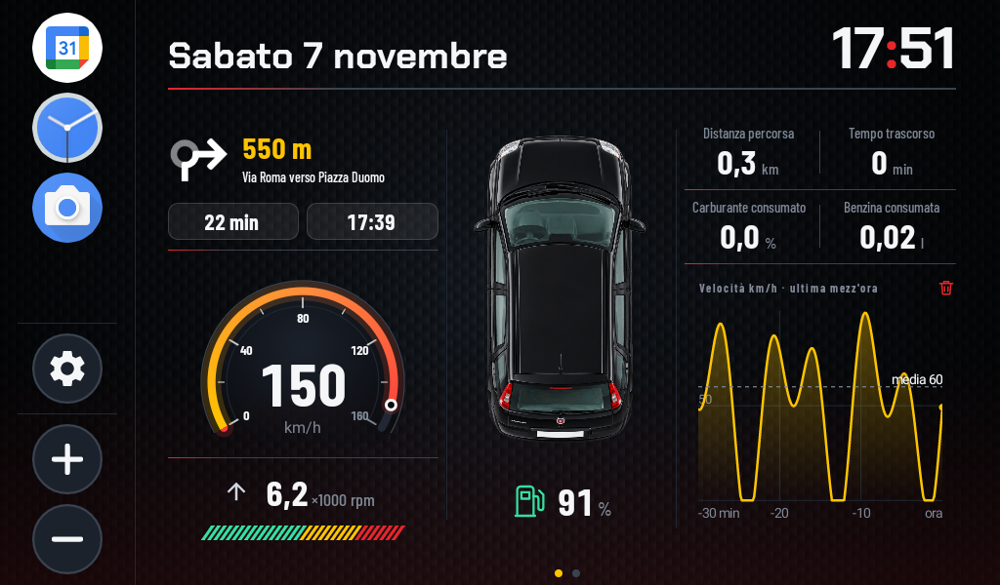
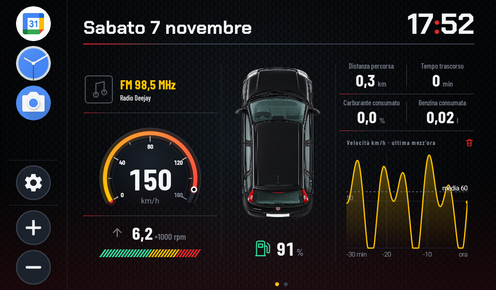
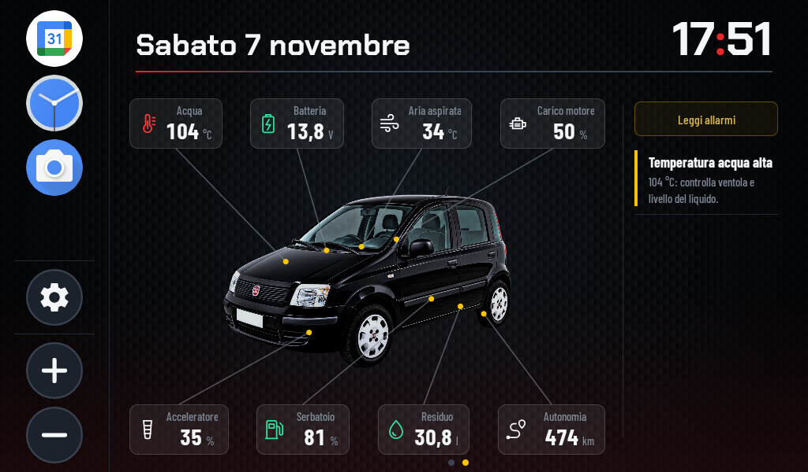
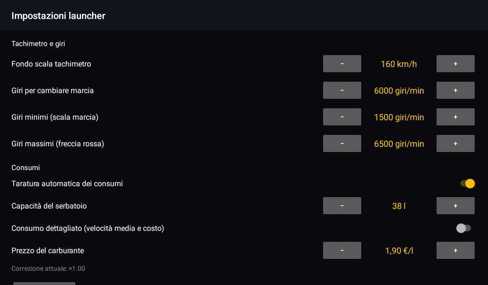

# Panda Launcher

[🇮🇹 Italiano](README.it.md) · 🇬🇧 English

**A custom digital dashboard for a Fiat Panda 169, built from scratch as an Android launcher for a Chinese car head unit.**

The stock head unit shows a grid of icons and a music app. This project turns it into an instrument cluster: hand-drawn speedometer
and tachometer, real data read from the engine ECU, Google Maps turn-by-turn right on the home screen, the radio frequency,
and engine fault diagnosis. Everything is written in Java with no third-party UI libraries, and designed to be read
at a glance while driving.



## What it does

### Home: speed, revs and trip in three columns

- **Speedometer** drawn entirely in code (`GaugeView`): dark dial with a gradient, 240° arc, ticks and numbers, configurable full scale.
- **Engine revs** in thousands, with a segmented bar that fills up to the shift point (configurable).
  A grey arrow blinks upward when it is time to shift up, and downward when you are driving below the minimum revs.
- **Top-down car image** in the middle, with the fuel level.
- **Trip computer**: distance, time, fuel used as a percentage and in litres, and (optionally) average speed and cost in euro.
  Below, a speed chart for the last half hour, with the average.
- **"Extra data" section above the speedometer**, set to *Off*, *Navigation* or *Radio*:

| Navigation (goESP) | Radio |
|---|---|
|  |  |

  - **Navigation**: manoeuvre arrow, distance, street name, remaining time and arrival time. The data comes from the **goESP** app
    on the phone, which the launcher impersonates as if it were its display.
  - **Radio**: the frequency (notification title and text) read from the head unit's radio app notification.

### Second page: the car and its data

The car sits in the middle, with data above and below connected by lines to points on the bodywork. On the right, in a narrow column
because it is usually empty, the fault codes read from the ECU.



- **Measured**: coolant temperature, battery voltage (with a charging icon when the alternator is working), fuel level,
  intake air temperature, engine load, throttle position.
- **Estimated**: remaining fuel in litres and driving range, computed from the average consumption of the trip.
- **Faults**: a *Read alarms* button and a list with the check-engine light, stored and pending fault codes, and warnings derived
  from live values (coolant too hot, battery not charging). Fault codes are described in Italian.

### The rest

- Column of pinned apps, with settings and volume buttons.
- Icons, text and translucent boxes designed to be legible from the driver's seat on a dark screen.
- Demo mode with fake data to try the whole interface without a car or an adapter.

The app interface is in Italian.

## Under the hood

**OBD without garage tools.** A cheap ELM327 adapter talks to the ECU over Bluetooth (RFCOMM).
The launcher requests the standard PIDs one at a time (the Fire engine ECU answers in about 280 ms per request),
parses them and builds a snapshot of the data. Reading continues while another app is in the foreground.

**A consumption figure nobody gives you, estimated well.** The Fire engine does not report fuel consumption and usually not even air flow.
`FuelEstimator` rebuilds it with the *speed-density* method: from manifold pressure, revs, intake air temperature
and engine displacement it computes the air mass, and from that the fuel (stoichiometric ratio 14.7).
`FuelCalibrator` then **calibrates itself**: it compares the estimated litres with the real drop of the fuel tank level
and corrects the model with a factor that updates slowly, ignoring noise and refuelling.
Trip cost and driving range come out of it too.

**A display the phone believes is real.** For navigation the launcher behaves like a goESP display (ESP32-based):
it advertises the same GATT service over Bluetooth Low Energy and the phone writes the manoeuvre packets to it.
No server, no cloud, no app to modify.

**The radio, without touching the radio.** A `NotificationListenerService` reads the playback notification of the radio app
(*transport* category or media style) and shows its title and text.

**Hand-drawn graphics.** Speedometer, rev bar, speed chart and the lines from the car are custom `View`s drawn on a `Canvas`:
the lines follow the points on the photo whatever the screen size.

**Diagnostics.** OBD-II fault code decoding (modes 03 and 07) with a catalogue in Italian, and rules that turn
live values into warnings.

**Tested.** The parts with no Android dependencies (OBD parser, consumption estimates, calibration, trip, diagnostics, speed history)
are plain classes with JUnit tests.

## Project layout

```
FPLauncher/
  app/src/main/
    java/it/panda/launcher/
      LauncherActivity.java      home and second page, all the screen logic
      SettingsActivity.java      apps, OBD, extra data, model, speedometer, consumption
      AppPickerActivity.java     choice and order of the pinned apps
      Prefs.java                 saved settings
      obd/                       ELM327, PIDs, parser, consumption estimate, calibration, trip, diagnostics
      nav/                       goESP receiver over Bluetooth LE and navigation data
      radio/                     reading the radio app notification
      apps/                      list of installed apps
      ui/                        GaugeView, ShiftLightsView, CarLinesView, MetricCellView, chart
    assets/directions/           manoeuvre arrows
  app/src/test/                  JUnit tests
Extra/
  APK/                           compiled APK
  Immagini/                      car photos and screenshots
```

## Build and install

You need JDK 17 or later and the Android SDK (minSdk 24, targetSdk 34).

1. Open the `FPLauncher` folder in Android Studio, or from the command line:
   `gradle :app:assembleDebug :app:testDebugUnitTest`
2. The APK is at `FPLauncher/app/build/outputs/apk/debug/app-debug.apk`; a ready-made copy is in `Extra/APK/PandaLauncher.apk`.
3. Install it on the head unit (USB with debugging enabled, or from a USB stick).
4. Press Home and choose **Panda Launcher** → "Always". The original launcher stays installed and can be re-enabled.

## Settings

From the home screen, gear icon at the bottom left:



- **OBD**: enable it and choose the ELM327 adapter already paired in Android's Bluetooth settings (PIN usually `1234` or `0000`).
- **Extra data** ("Dati aggiuntivi"): Off, Navigation (goESP) or Radio. Radio needs notification access, granted from the system settings.
- **Model**: Fiat Panda 169 AXF1A 08B, 1242 cm³ (other models are added in `Prefs`).
- **Speedometer and revs**: full scale (160 km/h by default), shift revs (6000), minimum revs (1500), maximum revs (6500).
- **Consumption**: automatic calibration, tank capacity (38 l), detailed consumption with average speed and cost, fuel price (€1.90/l).

## Status

A personal project, in use and under development. The interface, OBD reading and estimates are tested; goESP navigation and radio reading
depend on the head unit hardware (Bluetooth LE peripheral mode, a radio app that publishes a playback notification).
Doors, windows and air conditioning are not part of standard OBD and would need the Fiat Body Computer commands.
